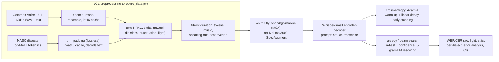

# Multi-dialect Arabic ASR with Whisper-small


This repository reimplements **Paper 3** from our Phase 1 report, Ozyilmaz, Coler and
Valdenegro-Toro, *Overcoming Data Scarcity in Multi-Dialectal Arabic ASR via Whisper
Fine-Tuning* (Interspeech 2025) [1]: full fine-tuning of OpenAI Whisper-small [2] on Modern
Standard Arabic (Common Voice [3]) and five dialect groups (MASC [4]: Egyptian, Gulf, Iraqi,
Levantine, Maghrebi).

We follow the paper's recipe and fix the limitation the authors name themselves: the
missing Arabic text normalisation. For that we adopt the preprocessing of **Paper 2**,
Grigoryan et al. (ICASSP 2025) [5], and report WER at three normalisation levels, so our
numbers can be compared with the paper's and the effect of spelling can be measured.

## What is implemented

| Brief item | Where | Notes |
|---|---|---|
| A. Python 3.9+, PyTorch, transformers [8] | `pyproject.toml`, `requirements.txt` | Package `arabic_asr` under `src/`, 40 unit tests |
| B. Real dataset, >= 10 h | `configs/data.yaml` | Common Voice 16.1 Arabic (~40 h train + 13 h test) and MASC dialects (~90 h), via the authors' Hugging Face copies [6] |
| C1. Preprocessing | `src/arabic_asr/data/` | Audio loading and resampling, Whisper log-Mel (own PyTorch implementation, verified against Hugging Face), waveform augmentation plus SpecAugment [9], three-level Arabic text normalisation, training-data filters, leakage removal, speaker-disjoint validation. See [docs/PREPROCESSING.md](docs/PREPROCESSING.md) |
| C2. Model | `src/arabic_asr/model/whisper_model.py` | Pre-trained `openai/whisper-small` (244M) fine-tuned end to end, as in the paper |
| C3. Training | `src/arabic_asr/training/trainer.py` | Custom loop: cross-entropy with teacher forcing, AdamW [11] (0.9, 0.99), warm-up plus linear decay, fp16/bf16, gradient clipping and checkpointing, validation loss and WER, early stopping, best and resumable checkpoints |
| C4. Inference | `src/arabic_asr/inference/` | Batch transcription, greedy or beam search, n-best alternatives with confidence scores, chunking for audio over 30 s, Kneser-Ney word 3-gram LM rescoring [10] |
| C5. Evaluation | `src/arabic_asr/evaluation/` | Corpus WER/CER at raw/light/strict levels with bootstrap CIs, per-dialect breakdown, substitution/deletion/insertion analysis, top confusions, hallucination flags, length buckets, gender/age/code-switching slices, calibration, paired significance tests, speed benchmark |
| C6. Demo UI | not yet | `Transcriber.transcribe()` already returns text, confidence and alternatives for the UI |

## How to run

Training needs a GPU. Use the notebook [notebooks/run_on_colab_kaggle.ipynb](notebooks/run_on_colab_kaggle.ipynb)
on Google Colab (T4) or Kaggle; it runs every step in order. [docs/EXPERIMENTS.md](docs/EXPERIMENTS.md)
explains each experiment, the expected reference numbers and rough run times.

The notebook clones this public repository (`REPO_URL` in its first cell), so no setup is
needed. If the repository is ever made private, add a GitHub fine-grained personal access
token with read access to it as a secret named `GITHUB_TOKEN` (Colab: key icon in the left
sidebar, then enable notebook access; Kaggle: Add-ons > Secrets); the notebook uses it
without printing or storing it. Alternatively, set `REPO_URL = ""` and upload a zip to
Google Drive:

```bash
cd .. && zip -r Speech-Processing.zip Speech-Processing -x "Speech-Processing/.venv/*" "Speech-Processing/.git/*" "Speech-Processing/cache/*" "Speech-Processing/runs/*" "*.pdf"
```

The main commands (all take `--help`):

```bash
python scripts/prepare_data.py --config configs/data.yaml --sources msa egyptian gulf iraqi levantine maghrebi
python scripts/train.py --config configs/e1_msa.yaml          # E1: MSA
python scripts/train.py --config configs/e2_pooled.yaml       # E2: five dialects pooled (main model)
python scripts/evaluate.py --model runs/e2_pooled/best --name e2_pooled --out results/e2_pooled
python scripts/transcribe.py --model runs/e2_pooled/best my_recording.wav --num-beams 5 --n-best 3
python scripts/analyze.py results/e0_paper_pooled results/e2_pooled --compare paper_pooled e2_pooled --out reports/main
```

Local CPU check (a laptop is enough; downloads ~0.6 GB):

```bash
python -m venv .venv && .venv/bin/pip install -e ".[dev]"
.venv/bin/python -m pytest
ASR_CACHE=cache ASR_RUNS=runs .venv/bin/python scripts/prepare_data.py --sources msa egyptian --max-rows 48
ASR_CACHE=cache ASR_RUNS=runs .venv/bin/python scripts/train.py --config configs/smoke_cpu.yaml
```

## Pipeline



## Experiments

| ID | Starting point | Training data | Purpose |
|---|---|---|---|
| E0 | `openai/whisper-small`, the authors' `ar_tsize_1.0` and `finetune_all_seed42` | none | Reproduce the paper's numbers with our evaluation; measure how much of its error is orthographic |
| E1 | `openai/whisper-small` | Common Voice MSA | Paper's RQ1 model plus our preprocessing |
| E2 | E1 | 5 MASC dialects pooled + 15% MSA replay | Main and demo model; the paper's pooled model, with less MSA forgetting |
| E3 (optional) | E1 | Egyptian only | Dialect-specific vs. pooled (the paper's RQ3) |

## Where we differ from the paper and its code

| Topic | Paper [1] / released code [7] | Here |
|---|---|---|
| Text | Raw transcripts for training and scoring | Light-normalised targets; scoring at raw (comparable), light and strict |
| AdamW β₂ | Paper 0.99, code 0.999 (library default) | 0.99 as the paper states |
| Checkpoint selection | Paper: validation loss; code: WER | Validation loss (configurable) |
| Validation set | Random 20%, all utterances decoded every 250 steps | Speaker-disjoint for MSA; loss on a fixed subset, WER on a smaller subset (decoding the whole set every time is why the paper's evaluation took ~92 A100-hours) |
| Augmentation | None | Speed, gain, noise (MSA audio); SpecAugment (all) |
| Pooled model | 5,000 steps like single-dialect models | 8,000 steps with early stopping, plus MSA replay |
| Training failures | Retries the run up to 10 times | Exact resume from the last checkpoint |
| Seeds | 3 | 1 (compute budget); stated as a limitation |
| Preprocessing code | Not released | `src/arabic_asr/data/` |

One bug the tests caught: in transformers 4.x, `WhisperTokenizerFast.from_pretrained(...,
language="arabic")` silently omits the `<|ar|><|transcribe|>` tokens. We call
`set_prefix_tokens` and assert the prefix (`data/prepare.py: load_tokenizer`).

## Results

No GPU runs yet. Fill this section from `results/*/summary.csv` and `reports/*/report.md`
after running the notebook.

## Repository layout

```
configs/      data.yaml, e1_msa.yaml, e2_pooled.yaml, e3_egyptian.yaml, smoke_cpu.yaml
docs/         PREPROCESSING.md, EXPERIMENTS.md
notebooks/    run_on_colab_kaggle.ipynb
scripts/      prepare_data, train, evaluate, transcribe, train_lm, tune_lm, analyze, benchmark_speed, push_to_hub
src/arabic_asr/
  data/       text_normalization, filtering, audio, features, augmentation, cache, prepare, splits, dataset
  model/      whisper_model, hub
  training/   trainer, checkpointing
  inference/  transcriber, lm (Kneser-Ney), rescoring
  evaluation/ metrics, error_analysis, statistics, report, runner, paper_reference
tests/        40 unit tests (synthetic data and a tiny random Whisper; no GPU or dataset download needed)
```

## References

[1] Ö. T. Özyilmaz, M. Coler, and M. Valdenegro-Toro, "Overcoming data scarcity in multi-dialectal Arabic ASR via Whisper fine-tuning," in *Proc. Interspeech 2025*, Rotterdam, The Netherlands, Aug. 2025, pp. 1158–1162, doi: 10.21437/Interspeech.2025-2260.

[2] A. Radford, J. W. Kim, T. Xu, G. Brockman, C. McLeavey, and I. Sutskever, "Robust speech recognition via large-scale weak supervision," in *Proc. 40th Int. Conf. Mach. Learn. (ICML)*, Honolulu, HI, USA, Jul. 2023, pp. 28492–28518.

[3] R. Ardila *et al.*, "Common Voice: A massively-multilingual speech corpus," in *Proc. 12th Lang. Resour. Eval. Conf. (LREC)*, Marseille, France, May 2020, pp. 4218–4222.

[4] M. Al-Fetyani, M. Al-Barham, G. Abandah, A. Alsharkawi, and M. Dawas, "MASC: Massive Arabic speech corpus," in *Proc. IEEE Spoken Language Technology Workshop (SLT)*, 2023, pp. 1006–1013.

[5] L. Grigoryan, N. Karpov, E. Albasiri, V. Lavrukhin, and B. Ginsburg, "Open automatic speech recognition models for classical and modern standard Arabic," in *Proc. IEEE ICASSP*, 2025. arXiv:2507.13977.

[6] otozz, "Overcoming data scarcity in multi-dialectal Arabic ASR," Hugging Face collection (models and preprocessed datasets). [Online]. Available: https://huggingface.co/collections/otozz/overcoming-data-scarcity-in-multi-dialectal-arabic-asr

[7] Ö. T. Özyilmaz, *finetune-ar-dialects*, GitHub repository, 2025, doi: 10.5281/zenodo.15553149. [Online]. Available: https://github.com/O-T-O-Z/finetune-ar-dialects

[8] T. Wolf *et al.*, "Transformers: State-of-the-art natural language processing," in *Proc. EMNLP: System Demonstrations*, 2020, pp. 38–45.

[9] D. S. Park *et al.*, "SpecAugment: A simple data augmentation method for automatic speech recognition," in *Proc. Interspeech*, 2019, pp. 2613–2617.

[10] S. F. Chen and J. Goodman, "An empirical study of smoothing techniques for language modeling," *Computer Speech & Language*, vol. 13, no. 4, pp. 359–394, 1999.

[11] I. Loshchilov and F. Hutter, "Decoupled weight decay regularization," in *Proc. ICLR*, 2019.
